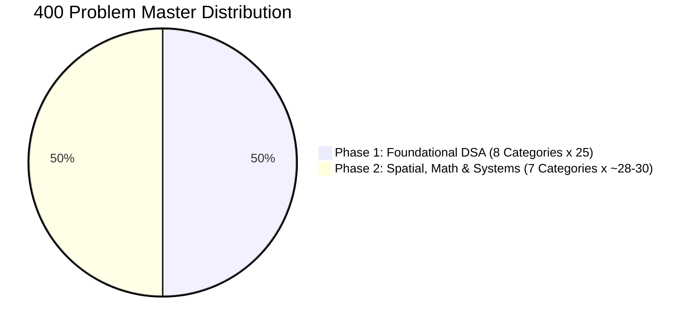

# Algorithmic Foundations & Systems Practice

> **Personal Engineering Laboratory for Praveen Kumar J**  
> Bridging Mathematical Rigor, Computer Vision, and Systems Engineering via Deliberate Problem Solving.

---

## 🏛️ Strategic Vision & Target Archetypes

This repository is **not** for generic web CRUD / fullstack interview preparation. It is an algorithmic laboratory designed for a **1–2 year horizon** targeting senior roles at the intersection of **Machine Learning Systems, Image Processing / Perception, and High-Performance Numerical Computing**:

1. **Edge AI & Computer Vision Systems Engineer** *(Apple, Qualcomm, Sony Semiconductor, HP Labs, Zebra Technologies)*
2. **Autonomous Systems & Robotics Perception (3D Geometry & SLAM)** *(Waymo, Cruise, Zoox, Tesla Autopilot, Skydio)*
3. **ML Systems & High-Performance Inference (HPC & Kernels)** *(NVIDIA TensorRT/CUTLASS, AMD ROCm, Modular, Tenstorrent)*
4. **Computational Geometry & Quantitative Systems** *(Synopsys, Cadence, Citadel, HRT, Two Sigma)*

---

## 🧭 The Evolutionary Engineering Methodology

We do **not** jump directly to the final optimal solution. Every problem is an iterative study of trade-offs:


### File Conventions Inside Each Problem Directory
Every problem is contained within its own dedicated folder:
```text
0001_two_sum/
├── README.md        # Problem prompt, evolution chain (Step 1 -> Step N), and Python ➔ C++ Bridge notes
├── solution.py      # Contains SolutionV1, SolutionV2, ... SolutionOptimal
└── solution.cpp     # Modern C++ counterpart mirroring each version with memory/cache insights
```

* **One isolated improvement per iteration:** Each version introduces exactly **one change** (e.g., pruning unnecessary search space, eliminating redundant passes, pre-allocating memory buckets, or passing by reference).
* **Quantified Impact:** Document the exact delta in Time Complexity, Space Complexity, or Memory/Cache performance.
* **The Python ➔ C++ Bridge:** For each step, analyze what Python does under the hood (dynamic typing, reference counting, hash table resizing) vs. what modern C++ does (compile-time types, contiguous cache lines, zero-copy `const &`).

---

## 📚 Accompanying Reading Stack

| Book | Author | Role in Your Journey |
| :--- | :--- | :--- |
| **Introduction to the Design and Analysis of Algorithms** | *Anany Levitin* | **Algorithmic Meta-Strategies:** Organizes problem solving by design technique (Decrease-and-Conquer, Transform-and-Conquer, Space-Time Trade-offs, Iterative Improvement). Directly aligns with mathematical thinking. |
| **A Tour of C++ (3rd Edition, C++20)** | *Bjarne Stroustrup* | **Modern C++ Reference:** Concise guide to modern C++ idioms, RAII, STL containers, iterators, move semantics, and standard library algorithms without legacy C baggage. |
| **Effective Modern C++** | *Scott Meyers* | **Systems Deep Dive:** Follow-up read for mastering `std::move`, universal references, lambda captures, and memory management. |

---

## 🗺️ Master Curriculum: 400 Problems (200 + 200)

> 📊 **Live progress, completion metrics, and problem logs are tracked in [PROGRESS.md](file:///PROGRESS.md).**



---

# 🚀 PHASE 1: FOUNDATIONAL DSA (Screening Defense & Core Reflexes)

Each category features **25 problems** (7 Easy, 13 Medium, 5 Hard). Below is the syllabus across the 8 categories:

### Category 01: Arrays, Two Pointers & Prefix Sums
*Guide:* [`phase_1_foundations/01_arrays_two_pointers_prefix_sums/README.md`](file:///phase_1_foundations/01_arrays_two_pointers_prefix_sums/README.md)

| ID | Problem Name | Difficulty | Core Pattern |
| :---: | :--- | :---: | :--- |
| `0001` | [Two Sum](https://leetcode.com/problems/two-sum/) | Easy | Hash Map Complement / Space-Time Trade-off |
| `0167` | [Two Sum II - Input Array Is Sorted](https://leetcode.com/problems/two-sum-ii-input-array-is-sorted/) | Easy | Converging Two Pointers ($L \to, \gets R$) |
| `0283` | [Move Zeroes](https://leetcode.com/problems/move-zeroes/) | Easy | Fast & Slow (Read/Write) Pointers |
| `0026` | [Remove Duplicates from Sorted Array](https://leetcode.com/problems/remove-duplicates-from-sorted-array/) | Easy | In-place Boundary Maintenance |
| `0027` | [Remove Element](https://leetcode.com/problems/remove-element/) | Easy | In-place Overwrite |
| `0977` | [Squares of a Sorted Array](https://leetcode.com/problems/squares-of-a-sorted-array/) | Easy | Converging Two Pointers on Extremes |
| `0724` | [Find Pivot Index](https://leetcode.com/problems/find-pivot-index/) | Easy | 1D Prefix Sum Balance |
| `0015` | [3Sum](https://leetcode.com/problems/3sum/) | Medium | Sorting + Two Pointers with Deduplication |
| `0016` | [3Sum Closest](https://leetcode.com/problems/3sum-closest/) | Medium | Two Pointers with Delta Tracking |
| `0018` | [4Sum](https://leetcode.com/problems/4sum/) | Medium | Generalized K-Sum Recursion |
| `0011` | [Container With Most Water](https://leetcode.com/problems/container-with-most-water/) | Medium | Greedy Two Pointers / Area Invariant |
| `0238` | [Product of Array Except Self](https://leetcode.com/problems/product-of-array-except-self/) | Medium | Prefix & Suffix Accumulator |
| `0560` | [Subarray Sum Equals K](https://leetcode.com/problems/subarray-sum-equals-k/) | Medium | Prefix Sum + Hash Map Frequency |
| `0525` | [Contiguous Array](https://leetcode.com/problems/contiguous-array/) | Medium | Prefix Sum Relative Transform (0 $\to$ -1) |
| `0974` | [Subarray Sums Divisible by K](https://leetcode.com/problems/subarray-sums-divisible-by-k/) | Medium | Prefix Modulo Bucketing |
| `0075` | [Sort Colors](https://leetcode.com/problems/sort-colors/) | Medium | 3-Way Partitioning (Dutch National Flag) |
| `0080` | [Remove Duplicates from Sorted Array II](https://leetcode.com/problems/remove-duplicates-from-sorted-array-ii/) | Medium | Read/Write with Lookback Window |
| `0189` | [Rotate Array](https://leetcode.com/problems/rotate-array/) | Medium | 3-Step Array Reversal |
| `0056` | [Merge Intervals](https://leetcode.com/problems/merge-intervals/) | Medium | Interval Sorting & Sweep |
| `0057` | [Insert Interval](https://leetcode.com/problems/insert-interval/) | Medium | Three-stage Interval Partitioning |
| `0042` | [Trapping Rain Water](https://leetcode.com/problems/trapping-rain-water/) | Hard | Two Pointers Boundary Envelope |
| `0041` | [First Missing Positive](https://leetcode.com/problems/first-missing-positive/) | Hard | Array as Cyclic Hash Table ($O(1)$ Space) |
| `0128` | [Longest Consecutive Sequence](https://leetcode.com/problems/longest-consecutive-sequence/) | Hard / Med | Hash Set Sequence Boundary Expansion |
| `0325` | [Maximum Size Subarray Sum Equals k](https://leetcode.com/problems/maximum-size-subarray-sum-equals-k/) | Medium | Prefix Sum First-Seen Index Map |
| `0454` | [4Sum II](https://leetcode.com/problems/4sum-ii/) | Medium | Space-Time Meet in the Middle |

---

### Category 02: Sliding Window & Deque
*Guide:* `phase_1_foundations/02_sliding_window/README.md`

| ID | Problem Name | Difficulty | Core Pattern |
| :---: | :--- | :---: | :--- |
| `0121` | [Best Time to Buy and Sell Stock](https://leetcode.com/problems/best-time-to-buy-and-sell-stock/) | Easy | 1D Rolling Minimum |
| `0643` | [Maximum Average Subarray I](https://leetcode.com/problems/maximum-average-subarray-i/) | Easy | Fixed-Size Window Sum |
| `0219` | [Contains Duplicate II](https://leetcode.com/problems/contains-duplicate-ii/) | Easy | Fixed-Size Window Hash Set |
| `1876` | [Substrings of Size Three with Distinct Characters](https://leetcode.com/problems/substrings-of-size-three-with-distinct-characters/) | Easy | Fixed Window Frequency Count |
| `0003` | [Longest Substring Without Repeating Characters](https://leetcode.com/problems/longest-substring-without-repeating-characters/) | Medium | Dynamic Window + Last Seen Index Map |
| `0424` | [Longest Repeating Character Replacement](https://leetcode.com/problems/longest-repeating-character-replacement/) | Medium | Dynamic Window with Max Frequency Cache |
| `0567` | [Permutation in String](https://leetcode.com/problems/permutation-in-string/) | Medium | Fixed Window Frequency Matching |
| `0438` | [Find All Anagrams in a String](https://leetcode.com/problems/find-all-anagrams-in-a-string/) | Medium | Rolling Character Histogram |
| `0209` | [Minimum Size Subarray Sum](https://leetcode.com/problems/minimum-size-subarray-sum/) | Medium | Dynamic Window Contraction |
| `0904` | [Fruit Into Baskets](https://leetcode.com/problems/fruit-into-baskets/) | Medium | At-Most-K Distinct Window |
| `1004` | [Max Consecutive Ones III](https://leetcode.com/problems/max-consecutive-ones-iii/) | Medium | Dynamic Window with Flip Budget |
| `1456` | [Maximum Number of Vowels in a Substring of Given Length](https://leetcode.com/problems/maximum-number-of-vowels-in-a-substring-of-given-length/) | Medium | Fixed Window State Update |
| `1208` | [Get Equal Substrings Within Budget](https://leetcode.com/problems/get-equal-substrings-within-budget/) | Medium | Prefix Cost Expansion |
| `0713` | [Subarray Product Less Than K](https://leetcode.com/problems/subarray-product-less-than-k/) | Medium | Multiplicative Sliding Window |
| `1658` | [Minimum Operations to Reduce X to Zero](https://leetcode.com/problems/minimum-operations-to-reduce-x-to-zero/) | Medium | Inverted Target Window |
| `0076` | [Minimum Window Substring](https://leetcode.com/problems/minimum-window-substring/) | Hard | Dynamic Window with Multi-char Constraints |
| `0239` | [Sliding Window Maximum](https://leetcode.com/problems/sliding-window-maximum/) | Hard | Monotonic Deque / 1D Max Filter |
| `0030` | [Substring with Concatenation of All Words](https://leetcode.com/problems/substring-with-concatenation-of-all-words/) | Hard | Multi-stride Sliding Window |
| `0992` | [Subarrays with K Different Integers](https://leetcode.com/problems/subarrays-with-k-different-integers/) | Hard | Exact K = (At Most K) - (At Most K-1) |

---

### Category 03: Fast Lookups (Hash Maps & Sets)
*Guide:* `phase_1_foundations/03_hash_maps_and_sets/README.md`

| ID | Problem Name | Difficulty | Core Pattern |
| :---: | :--- | :---: | :--- |
| `0217` | [Contains Duplicate](https://leetcode.com/problems/contains-duplicate/) | Easy | Set Membership Check |
| `0242` | [Valid Anagram](https://leetcode.com/problems/valid-anagram/) | Easy | Character Frequency Histogram |
| `0383` | [Ransom Note](https://leetcode.com/problems/ransom-note/) | Easy | Frequency Budget Consumption |
| `0205` | [Isomorphic Strings](https://leetcode.com/problems/isomorphic-strings/) | Easy | Bijective Mapping Invariant |
| `0290` | [Word Pattern](https://leetcode.com/problems/word-pattern/) | Easy | Bi-directional Map Validation |
| `0049` | [Group Anagrams](https://leetcode.com/problems/group-anagrams/) | Medium | Canonical Representation Keying |
| `0347` | [Top K Frequent Elements](https://leetcode.com/problems/top-k-frequent-elements/) | Medium | Frequency Map + Bucket Sort |
| `0146` | [LRU Cache](https://leetcode.com/problems/lru-cache/) | Medium | Hash Map + Doubly Linked List ($O(1)$) |
| `0380` | [Insert Delete GetRandom O(1)](https://leetcode.com/problems/insert-delete-getrandom-o1/) | Medium | Dynamic Array + Hash Map Swap Invalidation |
| `0451` | [Sort Characters By Frequency](https://leetcode.com/problems/sort-characters-by-frequency/) | Medium | Bucket Sort on Frequency |
| `0128` | [Longest Consecutive Sequence](https://leetcode.com/problems/longest-consecutive-sequence/) | Medium | Set Start-of-Sequence Skip |
| `0432` | [All O`one Data Structure](https://leetcode.com/problems/all-oone-data-structure/) | Hard | Hash Map + Doubly Linked Buckets |
| `0460` | [LFU Cache](https://leetcode.com/problems/lfu-cache/) | Hard | Multi-Level Doubly Linked Frequency Lists |

---

### Category 04: Binary Search & Search Space Reduction
*Guide:* `phase_1_foundations/04_binary_search/README.md`

| ID | Problem Name | Difficulty | Core Pattern |
| :---: | :--- | :---: | :--- |
| `0704` | [Binary Search](https://leetcode.com/problems/binary-search/) | Easy | Classic Bisection on Monotonic Array |
| `0035` | [Search Insert Position](https://leetcode.com/problems/search-insert-position/) | Easy | Lower Bound Search |
| `0278` | [First Bad Version](https://leetcode.com/problems/first-bad-version/) | Easy | Monotonic Predicate Invariant |
| `0367` | [Valid Perfect Square](https://leetcode.com/problems/valid-perfect-square/) | Easy | Integer Domain Search Space |
| `0033` | [Search in Rotated Sorted Array](https://leetcode.com/problems/search-in-rotated-sorted-array/) | Medium | Piecewise Monotonic Halves |
| `0081` | [Search in Rotated Sorted Array II](https://leetcode.com/problems/search-in-rotated-sorted-array-ii/) | Medium | Duplicate Disambiguation ($O(N)$ worst) |
| `0153` | [Find Minimum in Rotated Sorted Array](https://leetcode.com/problems/find-minimum-in-rotated-sorted-array/) | Medium | Pivot Discontinuity Detection |
| `0034` | [Find First and Last Position of Element in Sorted Array](https://leetcode.com/problems/find-first-and-last-position-of-element-in-sorted-array/) | Medium | Exact Left and Right Bound Hunting |
| `0074` | [Search a 2D Matrix](https://leetcode.com/problems/search-a-2d-matrix/) | Medium | Flat Index Virtualization ($r = \lfloor i/C \rfloor, c = i \bmod C$) |
| `0240` | [Search a 2D Matrix II](https://leetcode.com/problems/search-a-2d-matrix-ii/) | Medium | Saddleback Search ($O(M+N)$ Top-Right Pivot) |
| `0875` | [Koko Eating Bananas](https://leetcode.com/problems/koko-eating-bananas/) | Medium | Binary Search on Answer Space |
| `1011` | [Capacity To Ship Packages Within D Days](https://leetcode.com/problems/capacity-to-ship-packages-within-d-days/) | Medium | Monotonic Feasibility Function |
| `0004` | [Median of Two Sorted Arrays](https://leetcode.com/problems/median-of-two-sorted-arrays/) | Hard | Dual-Partition Cut Invariant ($O(\log(\min(M, N)))$) |
| `0410` | [Split Array Largest Sum](https://leetcode.com/problems/split-array-largest-sum/) | Hard | Min-Max Allocation over Answer Domain |

---

### Category 05: Stacks & Monotonic Stacks
*Guide:* `phase_1_foundations/05_stacks_and_monotonic_stacks/README.md`

| ID | Problem Name | Difficulty | Core Pattern |
| :---: | :--- | :---: | :--- |
| `0020` | [Valid Parentheses](https://leetcode.com/problems/valid-parentheses/) | Easy | LIFO Nesting Invariant |
| `0155` | [Min Stack](https://leetcode.com/problems/min-stack/) | Medium / Easy | Auxiliary Min Tracking |
| `0150` | [Evaluate Reverse Polish Notation](https://leetcode.com/problems/evaluate-reverse-polish-notation/) | Medium | Postfix Expression Evaluation |
| `0739` | [Daily Temperatures](https://leetcode.com/problems/daily-temperatures/) | Medium | Monotonic Decreasing Stack |
| `0496` | [Next Greater Element I](https://leetcode.com/problems/next-greater-element-i/) | Easy | Monotonic Stack + Map Lookup |
| `0503` | [Next Greater Element II](https://leetcode.com/problems/next-greater-element-ii/) | Medium | Circular Array Double-Length Unroll |
| `0901` | [Online Stock Span](https://leetcode.com/problems/online-stock-span/) | Medium | Monotonic Compression with Weights |
| `0394` | [Decode String](https://leetcode.com/problems/decode-string/) | Medium | Dual Stack (Multiplier + Substring) |
| `0084` | [Largest Rectangle in Histogram](https://leetcode.com/problems/largest-rectangle-in-histogram/) | Hard | Monotonic Increasing Boundary Tracking |
| `0085` | [Maximal Rectangle](https://leetcode.com/problems/maximal-rectangle/) | Hard | 2D Dynamic Histogram Reduction |

---

### Category 06: Binary Trees & Hierarchies
*Guide:* `phase_1_foundations/06_binary_trees_and_traversals/README.md`

| ID | Problem Name | Difficulty | Core Pattern |
| :---: | :--- | :---: | :--- |
| `0104` | [Maximum Depth of Binary Tree](https://leetcode.com/problems/maximum-depth-of-binary-tree/) | Easy | Recursive Tree DFS |
| `0226` | [Invert Binary Tree](https://leetcode.com/problems/invert-binary-tree/) | Easy | Symmetric Child Swap |
| `0100` | [Same Tree](https://leetcode.com/problems/same-tree/) | Easy | Dual-Tree Structural DFS |
| `0101` | [Symmetric Tree](https://leetcode.com/problems/symmetric-tree/) | Easy | Mirror Tree Reflection |
| `0543` | [Diameter of Binary Tree](https://leetcode.com/problems/diameter-of-binary-tree/) | Easy | Post-order Max Path Accumulation |
| `0102` | [Binary Tree Level Order Traversal](https://leetcode.com/problems/binary-tree-level-order-traversal/) | Medium | Queue BFS with Level Sizing |
| `0103` | [Binary Tree Zigzag Level Order Traversal](https://leetcode.com/problems/binary-tree-zigzag-level-order-traversal/) | Medium | BFS with Alternating Deque Direction |
| `0098` | [Validate Binary Search Tree](https://leetcode.com/problems/validate-binary-search-tree/) | Medium | Min/Max Valid Range Propagation |
| `0236` | [Lowest Common Ancestor of a Binary Tree](https://leetcode.com/problems/lowest-common-ancestor-of-a-binary-tree/) | Medium | Bottom-up Node Propagation |
| `0105` | [Construct Binary Tree from Preorder and Inorder Traversal](https://leetcode.com/problems/construct-binary-tree-from-preorder-and-inorder-traversal/) | Medium | Divide-and-Conquer Subtree Slicing |
| `0124` | [Binary Tree Maximum Path Sum](https://leetcode.com/problems/binary-tree-maximum-path-sum/) | Hard | Subtree Max Gain vs Turn Path |
| `0297` | [Serialize and Deserialize Binary Tree](https://leetcode.com/problems/serialize-and-deserialize-binary-tree/) | Hard | Preorder Stream Encoding |

---

### Category 07: Heaps & Priority Queues
*Guide:* `phase_1_foundations/07_heaps_and_priority_queues/README.md`

| ID | Problem Name | Difficulty | Core Pattern |
| :---: | :--- | :---: | :--- |
| `0703` | [Kth Largest Element in a Stream](https://leetcode.com/problems/kth-largest-element-in-a-stream/) | Easy | Min-Heap Fixed Capacity $K$ |
| `1046` | [Last Stone Weight](https://leetcode.com/problems/last-stone-weight/) | Easy | Max-Heap Simulation |
| `0215` | [Kth Largest Element in an Array](https://leetcode.com/problems/kth-largest-element-in-an-array/) | Medium | Min-Heap of Size $K$ or Quickselect ($O(N)$) |
| `0347` | [Top K Frequent Elements](https://leetcode.com/problems/top-k-frequent-elements/) | Medium | Frequency Map + Min-Heap |
| `0973` | [K Closest Points to Origin](https://leetcode.com/problems/k-closest-points-to-origin/) | Medium | Max-Heap on Euclidean Distance |
| `0621` | [Task Scheduler](https://leetcode.com/problems/task-scheduler/) | Medium | Max-Heap Cooldown Queue |
| `0295` | [Find Median from Data Stream](https://leetcode.com/problems/find-median-from-data-stream/) | Hard | Dual Balanced Heaps (Max-Heap + Min-Heap) |
| `0023` | [Merge k Sorted Lists](https://leetcode.com/problems/merge-k-sorted-lists/) | Hard | K-way Min-Heap Merge |

---

### Category 08: Grid & Graph Traversal
*Guide:* `phase_1_foundations/08_grid_and_graph_traversal/README.md`

| ID | Problem Name | Difficulty | Core Pattern |
| :---: | :--- | :---: | :--- |
| `0733` | [Flood Fill](https://leetcode.com/problems/flood-fill/) | Easy | 4-Connected DFS/BFS Color Propagation |
| `0463` | [Island Perimeter](https://leetcode.com/problems/island-perimeter/) | Easy | Boundary Edge Counting |
| `0200` | [Number of Islands](https://leetcode.com/problems/number-of-islands/) | Medium | Connected Component Labeling (CCL) |
| `0695` | [Max Area of Island](https://leetcode.com/problems/max-area-of-island/) | Medium | Component Area Accumulation |
| `0994` | [Rotting Oranges](https://leetcode.com/problems/rotting-oranges/) | Medium | Multi-source BFS Wave Propagation |
| `0417` | [Pacific Atlantic Water Flow](https://leetcode.com/problems/pacific-atlantic-water-flow/) | Medium | Reverse BFS/DFS from Boundaries |
| `0130` | [Surrounded Regions](https://leetcode.com/problems/surrounded-regions/) | Medium | Border-Connected Component Protection |
| `0127` | [Word Ladder](https://leetcode.com/problems/word-ladder/) | Hard | Unweighted Shortest Path (Bidirectional BFS) |
| `0329` | [Longest Increasing Path in a Matrix](https://leetcode.com/problems/longest-increasing-path-in-a-matrix/) | Hard | Grid DFS + Memoization / DAG Topological |

---

# 🔬 PHASE 2: SPATIAL, MATH & SYSTEMS SPECIALITY (Sneak Peek)

Detailed guides will be initialized as we reach Phase 2. Core problem highlights:

1. **2D/3D Geometry & Transforms:**  
   [48. Rotate Image](https://leetcode.com/problems/rotate-image/), [54. Spiral Matrix](https://leetcode.com/problems/spiral-matrix/), [836. Rectangle Overlap](https://leetcode.com/problems/rectangle-overlap/), [223. Rectangle Area](https://leetcode.com/problems/rectangle-area/), [587. Erect the Fence (Convex Hull)](https://leetcode.com/problems/erect-the-fence/).
2. **Matrix Transforms & 2D Prefix Sums:**  
   [304. Range Sum Query 2D - Immutable](https://leetcode.com/problems/range-sum-query-2d-immutable/) *(Integral Images)*, [73. Set Matrix Zeroes](https://leetcode.com/problems/set-matrix-zeroes/).
3. **Distance Transforms & Morphology:**  
   [542. 01 Matrix](https://leetcode.com/problems/01-matrix/) *(Manhattan Distance Field)*, [1162. As Far from Land as Possible](https://leetcode.com/problems/as-far-from-land-as-possible/).
4. **Spatial Trees:**  
   [427. Construct Quad Tree](https://leetcode.com/problems/construct-quad-tree/), [558. Logical OR of Two Binary Grids](https://leetcode.com/problems/logical-or-of-two-binary-grids-represented-as-quad-trees/), [307. Range Sum Query - Mutable (Segment Tree)](https://leetcode.com/problems/range-sum-query-mutable/).
5. **Numerical Methods & Sampling:**  
   [50. Pow(x, n)](https://leetcode.com/problems/powx-n/) *(Matrix Exponentiation)*, [69. Sqrt(x)](https://leetcode.com/problems/sqrtx/) *(Newton-Raphson)*, [478. Generate Random Point in a Circle](https://leetcode.com/problems/generate-random-point-in-a-circle/) *(Rejection Sampling)*, [398. Random Pick Index](https://leetcode.com/problems/random-pick-index/) *(Reservoir Sampling)*.
6. **Bit Manipulation & Systems Concurrency:**  
   [190. Reverse Bits](https://leetcode.com/problems/reverse-bits/), [191. Number of 1 Bits](https://leetcode.com/problems/number-of-1-bits/), [1114. Print in Order](https://leetcode.com/problems/print-in-order/), [1188. Design Bounded Blocking Queue](https://leetcode.com/problems/design-bounded-blocking-queue/).