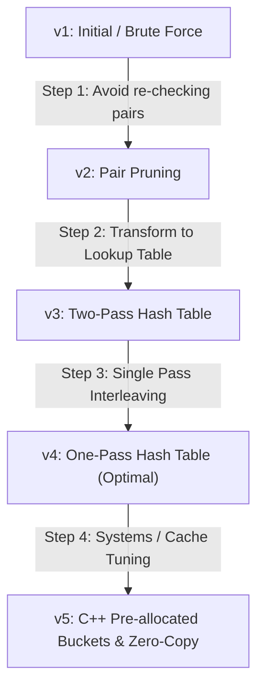

# 0001. Two Sum

- **LeetCode Link**: [1. Two Sum](https://leetcode.com/problems/two-sum/)
- **Difficulty**: Easy
- **Phase**: 1 (Foundations)
- **Category**: 01. Arrays, Two Pointers & Prefix Sums
- **Primary Concepts**: Array indexing, Complement search, Space-Time Trade-offs, Hash tables

---

## 1. Problem Statement

Given an array of integers `nums` and an integer `target`, return *indices of the two numbers such that they add up to `target`*.

You may assume that each input would have **exactly one solution**, and you may not use the same element twice.

You can return the answer in any order.

### Constraints
- $2 \le \text{nums.length} \le 10^4$
- $-10^9 \le \text{nums}[i] \le 10^9$
- $-10^9 \le \text{target} \le 10^9$
- **Only one valid answer exists.**

---

## 2. The Evolutionary Engineering Chain

*(This section will document the exact step-by-step improvements and metric deltas as we iterate together).*

---

## 3. Python ➔ C++ Bridge Notes

*(Documenting key language differences, memory layouts, reference semantics, and runtime behaviors for each version).*
